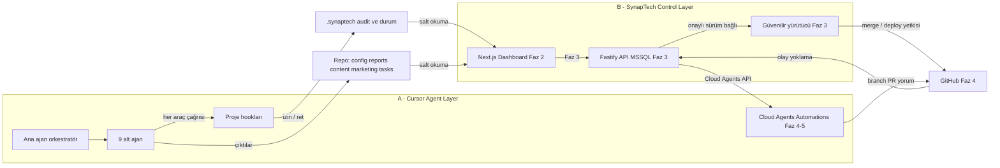
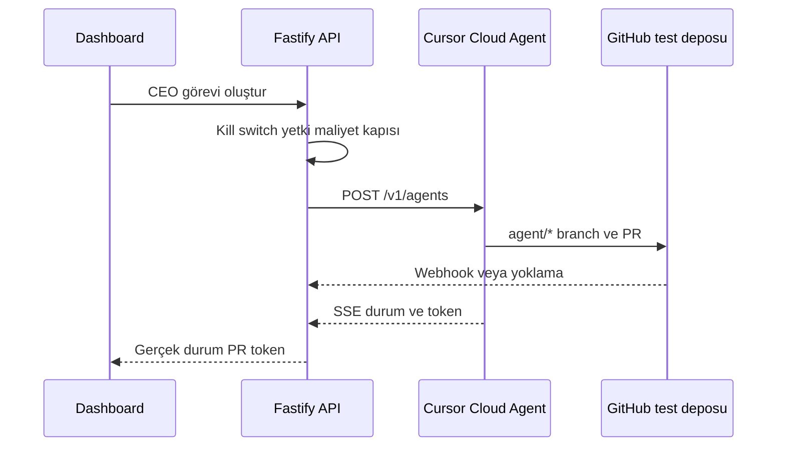

# Mimari

**Mevcut faz (kod):** Faz 3 Control Layer & Task Engine — Fastify + Prisma 7.10.1 + yerel MSSQL. Otonom değil.  
**config/system-status.yaml** korumalıdır; Owner manuel güncelleyene kadar Dashboard şeridi Faz 2 etiketini gösterebilir.

## İki katman

### Katman A — Cursor (ajan)

- Ana sohbet ajanı (orkestratör)
- 9 alt ajan (`.cursor/agents/`)
- Kurallar (`.cursor/rules/`, `AGENTS.md`)
- Proje hook’ları (`.cursor/hooks/guard.mjs`)
- Cloud Agents / Automations (Faz 4–5; maliyet kapısı sonrası; şu an kapalı)

### Katman B — Control (kontrol)

- Next.js Dashboard (Faz 2: salt okuma + DEMO)
- Fastify API + Prisma + MSSQL (Faz 3; henüz yok)
- Güvenilir yürütücü (Faz 3; onaylı işlemleri uygular; henüz yok)

## Diyagram (metin / Mermaid)



## Veri akışı — Faz 2 (şimdi)

1. Ajanlar çıktıyı `tasks/`, `reports/`, `content/`, `marketing/` altına yazar (readonly ajanlarda orkestratör yazar).
2. Hook’lar izin/ret olaylarını `.synaptech/` altına kaydeder (gitignore).
3. Dashboard **yalnızca okur**: config, ajan frontmatter, audit/durum, çıktı dosyaları.
4. DEMO verisi yalnızca DEMO görünümünde, tarayıcı deposundan gelir; Gerçek snapshot’a karışmaz.
5. Görev motoru, Cursor API ve GitHub bağlı değildir → Gerçek modda ilgili paneller boş / “bağlı değil”.

## Faz 3 — görev motoru (uygulandı)

| Bileşen | Sabit sürüm / seçim |
|---------|---------------------|
| API | Fastify (`apps/api`, `127.0.0.1:3101`) |
| ORM | `prisma@7.10.1`, `@prisma/client@7.10.1` |
| Adapter | `@prisma/adapter-mssql@7.10.1` |
| DB | SQL Server 2022 Docker: `synaptech-ai-os-mssql` → `localhost:14333` / DB `SynaptechAiOs` |
| Schema | `provider = "sqlserver"` (enum yok; String alanlar) |

**Prisma 8 kullanılmaz.** Mevcut SQLEXPRESS kullanılmaz. Volume: `synaptech_ai_os_mssql_data`.

Dashboard “CEO’ya görev gönder” formu API’ye yazar; kayıt `source: api` olarak MSSQL’de kalır (`dispatchState: awaiting_integration`). Cursor çağrısı yok.

## Faz 4 — CEO görev hattı ve zorunlu E2E

```text
Dashboard → API → Cloud Agent → GitHub (test deposu) → Dashboard
```



### Zorunlu kabul ölçütleri (hepsi)

1. Görev **Dashboard UI** üzerinden oluşturulur (doğrudan API çağrısı sayılmaz); DB’de gerçek kayıt görünür.
2. Gerçek `bc-` ajan kimliği oluşur; cursor.com/agents’ta görülür.
3. Ajan yalnızca ayrı **test deposunda**, `agent/*` branch’inde PR açar. Main/master yazma ve merge yok.
4. GitHub olayı API’ye ulaşır. Dashboard PR bağlantısını, `FINISHED` durumunu ve token kullanımını **Gerçek** etiketiyle gösterir.
5. Aynı testte kill switch senaryosu geçer (aşağıya bakın).

Not: Faz 4’te guard, yalnızca `agent/*` push’una izin verecek şekilde güncellenir; main/master push her zaman yasak.

Cloud Agents API v1’de webhook yok → yoklama veya v0 legacy; bkz. [integrations.md](integrations.md).

## Kill switch — fazlara göre etki

| Faz | Etki |
|-----|------|
| 1–2 (şimdi) | `config/kill-switch.json` `enabled: true` → hook’lar yeni alt ajanları ve okuma dışı araçları reddeder. Dashboard gösterir, değiştirmez. |
| 3 | Kullanıcı API ile açar/kapatır. Açıkken yeni görev ve ajana gönderme → HTTP **423**. Durum DB + hook dosyasına yazılır. |
| 4 | Aktif sistem run’ları `POST /v1/agents/{id}/runs/{runId}/cancel` ile iptal (`CANCELLED`). Harici run’lar listelenir; yerel SDK `run.cancel()`. |

Sınırlama: Bulut VM commit’lenmiş dosyayı kullanır; yerel kill switch dosyası çalışan VM’e yetmez → iptal API zorunlu.

## Maliyet kapısı (Cloud / Automations öncesi)

`config/budget-policy.yaml` → `cloud.cost_gate`. Kapı `not_started` iken Cloud Agents ve Automations açılmaz.

1. On-Demand kapalı + ilk kullanım harcama limiti ekranı kontrolü; On-Demand gerektiriyorsa dur.
2. Onayla test deposunda `composer-2.5` tek pilot; tüketim ölç.
3. Ölçüme göre sıklık öner; her otomasyon ayrı onay.

Ayrıntı: [automation-plan.md](automation-plan.md).

## Faz özeti

| Faz | İçerik | Durum |
|-----|--------|--------|
| 1 | Ajanlar, kurallar, hook’lar | Bu tur |
| 2 | Dashboard gözlem + DEMO | Bu tur (MVP) |
| 3 | Fastify + Prisma 7.10.1 + MSSQL | Planlandı |
| 4 | Cursor + GitHub + E2E | Planlandı |
| 5 | Automations (onaylı) | Planlandı; hepsi kapalı |
